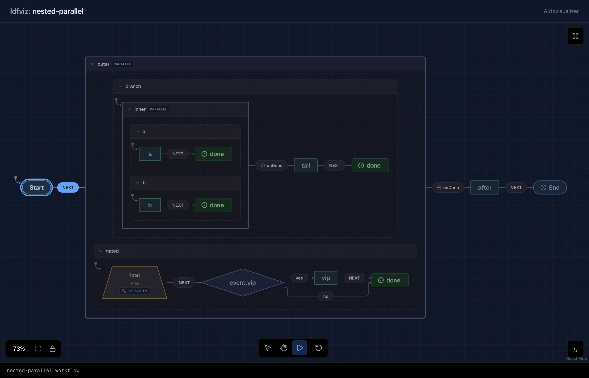
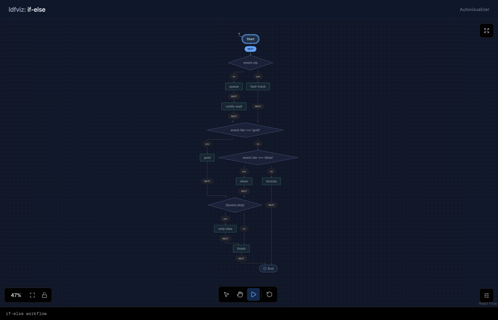
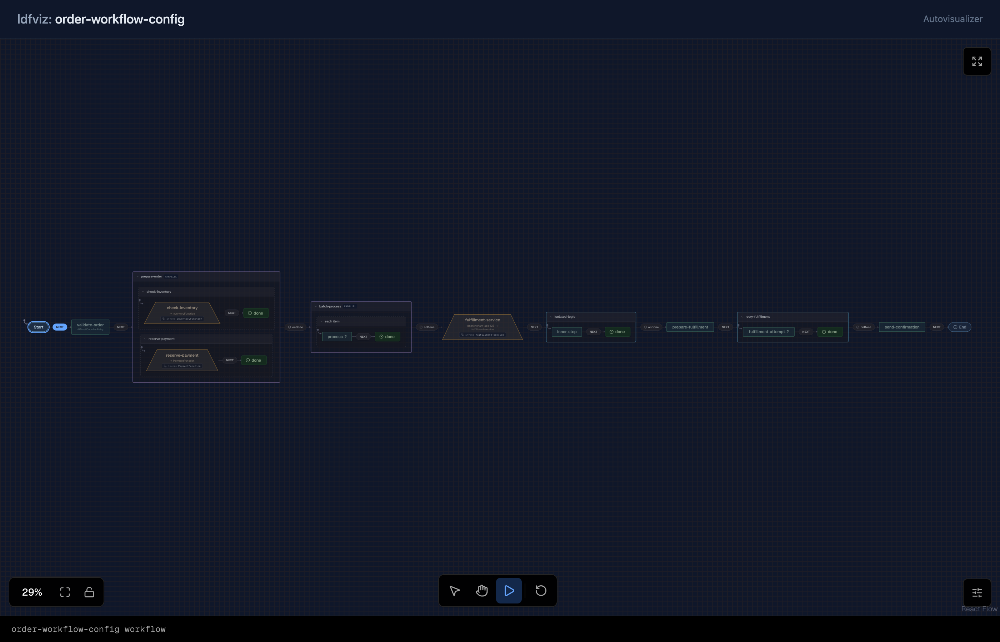
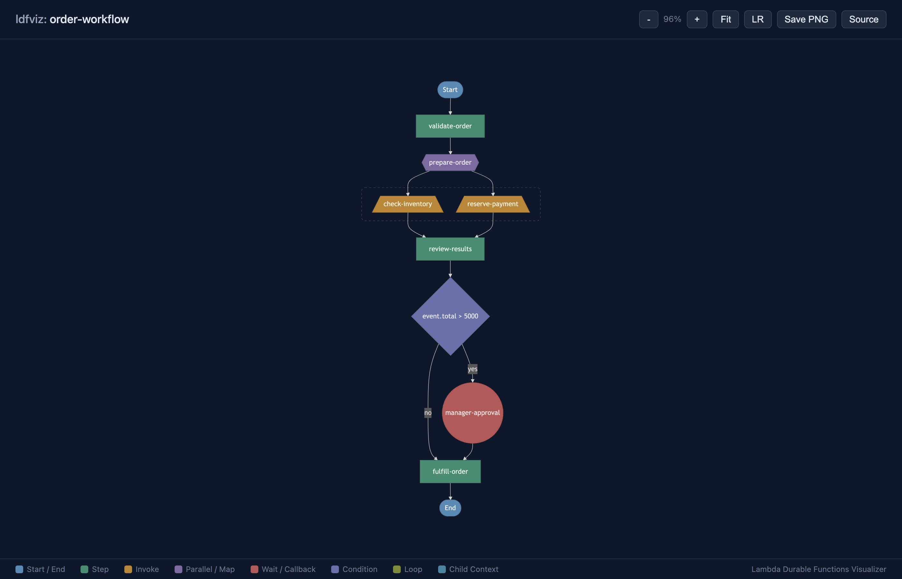

# AWS Lambda Durable Functions Visualizer

**See your AWS Lambda durable functions as diagrams, straight from the handler code: no deployment, no execution.**

<p align="center"></p>

<p align="center"><strong><code>npx aws-lambda-durable-functions-visualizer handler.ts --open</code></strong></p>

A [durable function](https://docs.aws.amazon.com/lambda/latest/dg/durable-functions.html) handler already describes a workflow: its steps, parallel branches, waits, callbacks and retries. This tool reads that handler and draws it, for **TypeScript/JavaScript, Python, Java, C# (.NET), Rust and Go**:

- **One command.** Point it at a handler and it opens the workflow in your browser, drawn by [Autovisualizer](https://github.com/jagreehal/autovisualizer), where you can click through it step by step.
- **The structure you wrote.** Parallel branches and their contents, nested parallels, `if` / `else`, loops, child contexts, retries and map callbacks, even when branches are built in a variable first.
- **For docs and reviews.** Print Mermaid for a README or pull request, or XState MachineJSON for anything that reads statecharts.
- **Your code never runs.** It is static analysis: nothing is imported, executed or deployed.

An independent project, not affiliated with or endorsed by Amazon Web Services.

## Quick start

Run it with `npx`, no install needed:

```shell
npx aws-lambda-durable-functions-visualizer handler.ts --open
```

`--open` writes a self-contained page and opens it. Without it, the workflow is printed as MachineJSON. Install it to get the short command `ldfviz`:

```shell
npm install -g aws-lambda-durable-functions-visualizer
ldfviz handler.py --open
```

Node.js 20 or later. The handler's own language toolchain is not needed.

## What you get

**Parallel branches show what they do.** Each branch is drawn with its own steps, and a parallel inside a branch is drawn inside it. Every branch ends in a `done` state, and the workflow moves on once they all are:

<p align="center"></p>

**Conditions branch both ways.** `if`, `else if` and `else` become diamonds with `yes` and `no`, and both sides rejoin where the code does. A branch that returns goes to End:

<p align="center"></p>

**Child contexts, retries and maps are boxes** holding the steps they run:

<p align="center"></p>

**Mermaid** for anywhere that renders it, such as GitHub Markdown and Notion:

```shell
ldfviz handler.ts --mermaid > workflow.mmd
ldfviz handler.ts --mermaid --open
```

<p align="center"></p>

## Put a diagram in a pull request

Draw the workflow on every pull request that touches a handler, in the job summary:

```yaml
# .github/workflows/workflow-diagram.yml
name: Workflow diagram
on:
  pull_request:
    paths: ["src/handlers/**"]
permissions:
  contents: read
jobs:
  diagram:
    runs-on: ubuntu-latest
    steps:
      - uses: actions/checkout@v7
      - uses: actions/setup-node@v7
        with:
          node-version: 24
      - name: Draw the handler
        run: |
          {
            echo '```mermaid'
            npx --yes aws-lambda-durable-functions-visualizer src/handlers/order.ts --mermaid
            echo '```'
          } >> "$GITHUB_STEP_SUMMARY"
```

GitHub renders the `mermaid` block in the summary. The same command keeps a diagram in your README up to date.

## CLI reference

```
Usage: ldfviz [options] <file>

Arguments:
  file                   Path to a durable function handler file

Options:
  -d, --direction <dir>  Mermaid graph direction: TD or LR (default: "TD")
  -n, --name <name>      Override the workflow name
  --mermaid              Output Mermaid flowchart syntax instead of MachineJSON
  --graph                Output the raw workflow graph as JSON
  --json                 Alias for MachineJSON output (the default)
  -o, --output <file>    Write output to a file instead of stdout
  --open                 Open the diagram in your browser
  -V, --version          Output the version number
  -h, --help             Display help
```

`aws-lambda-durable-functions-visualizer` and `ldfviz` are the same command.

| Output | Flag | Use it for |
| --- | --- | --- |
| MachineJSON | default, `--json` | XState statecharts. Open the file in [Autovisualizer](https://github.com/jagreehal/autovisualizer) or any tool that reads MachineJSON. |
| Mermaid | `--mermaid` | GitHub Markdown, Notion, docs sites. |
| Workflow graph | `--graph` | Your own tooling: nodes, edges, source lines and config. |
| Browser page | `--open` | Autovisualizer, or the Mermaid page with `--mermaid`. Combine with `-o` to keep the output too. |

Environment variables:

| Variable | Effect |
| --- | --- |
| `BROWSER=none` | `--open` writes the page and prints its path without launching a browser, for CI and remote shells. |
| `AUTOVISUALIZER_EMBED_URL` | Load the Autovisualizer embed from here instead of the pinned jsDelivr copy. |
| `AUTOVISUALIZER_URL` | Open your Autovisualizer app instead and print the `.machine.json` path to load with File → Open. |

## Supported primitives

| Primitive | TypeScript | Python | Java | C# (.NET) | Rust | Go |
| --- | --- | --- | --- | --- | --- | --- |
| Step | `context.step()` | `context.step()` | `ctx.step()` | `ctx.StepAsync()` | `ctx.step()` | `durable.Step()` |
| Invoke | `context.invoke()` | `context.invoke()` | `ctx.invoke()` | `ctx.InvokeAsync()` | `ctx.invoke()` | `durable.Invoke()` |
| Parallel | `context.parallel()` | `context.parallel()` | `ctx.parallel()` | `ctx.ParallelAsync()` | `ctx.parallel()` | `durable.Parallel()` |
| Map | `context.map()` | `context.map()` | `ctx.map()` | `ctx.MapAsync()` | `ctx.map()` | `durable.Map()` |
| Wait | `context.wait()` | `context.wait()` | `ctx.wait()` | `ctx.WaitAsync()` | `ctx.wait()` | `durable.Wait()` |
| Wait for Callback | `context.waitForCallback()` | `context.wait_for_callback()` | `ctx.waitForCallback()` | `ctx.WaitForCallbackAsync()` | `ctx.wait_for_callback()` | `durable.WaitForCallback()` |
| Create Callback | `context.createCallback()` | `context.create_callback()` | `ctx.createCallback()` | `ctx.CreateCallbackAsync()` | `ctx.create_callback()` | `durable.CreateCallback()` |
| Wait for Condition | `context.waitForCondition()` | `context.wait_for_condition()` | `ctx.waitForCondition()` | `ctx.WaitForConditionAsync()` | `ctx.wait_for_condition()` | `durable.WaitForCondition()` |
| Child Context | `context.runInChildContext()` | `context.run_in_child_context()` | `ctx.runInChildContext()` | `ctx.RunInChildContextAsync()` | `ctx.run_in_child_context()` | `durable.RunInChildContext()`, `durable.Go()` |
| With Retry | `withRetry(context, ...)` | `with_retry(context, ...)` | `ctx.withRetry(...)` | via `StepConfig` | `ctx.with_retry()` | `durable.Retry()` |

Also detected:

- **TypeScript:** `context.promise.all()`, `.any()`, `.race()` and `.allSettled()`.
- **Java:** `DurableFuture.allOf()` and `anyOf()`, and the `*Async` variants of each call.
- **Rust:** `join_all`, `try_join_all`, `select_ok`, `race`, `parallel_mixed`, `Branch::unnamed`, and the `.future()` and `.spawn()` builders.
- **Go:** `All`, `AllSettled`, `Any`, `Race`, `Join`, `Select`, `ParallelMixed` and the `*Async` variants.

Configuration is shown under each node's name: nesting type (`FLAT`/`NESTED`), completion config, step semantics (`AtMostOncePerRetry`), tenant isolation (`tenantId`) and concurrency limits, in all six languages.

### Shapes and colours

| Node | Shape | Colour |
| --- | --- | --- |
| Start / End | Stadium | Blue |
| Step | Rectangle | Green |
| Invoke | Trapezoid | Amber |
| Parallel / Map / Promise combinators | Hexagon | Purple |
| Wait / Callback | Circle | Red |
| Condition | Diamond | Indigo |
| Loop | Rounded rectangle, body in a dashed box | Olive |
| Child Context / With Retry | Subroutine | Teal |

Mermaid and Autovisualizer draw the same shapes. In MachineJSON each state carries `shape:<name>` and `color:<hex>` tags, which Autovisualizer reads.

## How it works

The handler is parsed, never run. TypeScript and JavaScript go through the TypeScript compiler's syntax tree ([ts-morph](https://github.com/dsherret/ts-morph)), which also resolves variables by scope. Python, Java, C#, Rust and Go are read by parsers written for each SDK's call shapes. Each finds the entry point:

| Language | Entry point |
| --- | --- |
| TypeScript / JavaScript | `withDurableExecution(handler)`, inline or a named function |
| Python | `@durable_execution`, with or without arguments |
| Java | a class extending `DurableHandler` (`handleRequest`, or another method taking a `DurableContext`) |
| C# | `DurableFunction.WrapAsync<TIn, TOut>(workflow, ...)` or a `[DurableExecution]` method |
| Rust | `durable::run(handler)` (also `run_with_options` and `wrap`) |
| Go | `durable.Start(handler)` (also `durable.Wrap`) |

From there, every parser:

- **Records each durable call** with its name, configuration and source line.
- **Follows functions in the same file:** helpers that take the durable context, branch functions and map callbacks.
- **Reads branches** written inline, in a same-file function, or in a variable in scope, including lists grown with `push`, `append`, `.Add` or `extend` before the call. Generated lists (`.map`, comprehensions, LINQ, branches added in a loop) become one dynamic "each item" branch.
- **Draws control flow:** `if` / `else if` / `else` (a branch that returns goes to End) and loops. A loop's body sits in a dashed box with a `next` edge back to the loop and a `done` edge out. Literal counts show on the label, such as `x3`.

The parsed workflow is one graph shared by every language, rendered as MachineJSON, Mermaid or JSON.

```
[handler] → parser (TS, Python, Java, C#, Rust, Go) → workflow graph → MachineJSON / Mermaid / graph JSON
```

## Examples

`examples/` has a handler per language and pattern:

| File | Language | Shows |
| --- | --- | --- |
| `order-workflow.ts` | TypeScript | step, parallel, invoke, waitForCallback, condition |
| `order-workflow-config.ts` | TypeScript | parallel, map, child context, retry, config |
| `order-batch-loop.ts` | TypeScript | loops, wait, waitForCallback, condition |
| `order_processor.py` | Python | step, wait, create_callback, invoke, condition |
| `order_processor_with_retry.py` | Python | parallel, map, retry, config |
| `order_batch_loop.py` | Python | loops |
| `OrderProcessor.java` | Java | step, parallel, wait, invoke, waitForCallback, condition |
| `OrderProcessorFutures.java` | Java | map, child context, retry, `allOf`, `anyOf`, config |
| `OrderBatchLoop.java` | Java | loops |
| `OrderWorkflow.cs` | C# | step, parallel, wait, waitForCallback, condition |
| `OrderProcessor.cs` | C# | step, parallel, wait, invoke, waitForCallback, condition |
| `OrderBatchLoop.cs` | C# | loops |
| `order_workflow.rs` | Rust | step, parallel, wait, waitForCallback, condition, concurrency |
| `order_workflow_config.rs` | Rust | invoke, map, child context, retry, waitForCondition, race, config |
| `order_batch_loop.rs` | Rust | loops |
| `order_workflow.go` | Go | step, parallel, wait, waitForCallback, condition |
| `order_workflow_config.go` | Go | invoke, map, child context, retry, waitForCondition, combinators, config |
| `order_batch_loop.go` | Go | loops |

```shell
npx aws-lambda-durable-functions-visualizer examples/order-workflow.ts --open
```

## Coverage and limits

Run over 1,854 real handlers (AWS's docs and SDK examples, AWS samples and community repos), **96%** are drawn with every durable call present: Rust, Java and C# 99%, Go 98%, Python 97%, TypeScript 92%. Most of the rest are files holding two handlers or deliberately invalid examples. That check counts calls, not structure, so structure is covered by the fixtures and tests instead.

Not drawn:

- **Code in other files.** Helpers, branch functions and workflows imported from another file are not followed.
- **Code chosen at runtime.** For example a strategy object's `execute(ctx)`, or branch lists passed in as a parameter or returned by a function.
- **Other control flow.** `switch`, `match`, ternaries, Rust's `if` as an expression, `break`, `continue`, Python's `for ... else`, and loops through callbacks (`forEach`, `.map`, LINQ).
- **Every path, not one run.** The diagram is every path the code allows, not what one execution did. Dynamic branches show every registered target.
- **Formatting edge cases.** The non-TypeScript parsers match braces textually, so a brace inside a string or comment can occasionally confuse a block's extent.
- **Mermaid layout.** Mermaid places the arrows, and busy fan-ins may overlap. Autovisualizer lays them out more cleanly.

## Contributing

```shell
pnpm install
pnpm build
node packages/cli/dist/bin.cjs examples/order-workflow.ts --open
```

| Command | Does |
| --- | --- |
| `pnpm quality` | Type check, lint, build, unit tests and end-to-end tests, as CI runs them |
| `pnpm test` | Parser and renderer unit tests (`packages/core`) |
| `pnpm test:e2e` | Opens the CLI's pages in Chromium and checks Autovisualizer and Mermaid draw them (run `pnpm exec playwright install chromium` once) |
| `pnpm screenshots` | Regenerates `.github/demo.svg` and `.github/screenshots/` after `pnpm build` |
| `pnpm changeset` | Describes your change for the changelog and the next release |

**Real-world check.** `tools/corpus/` measures the parsers against a corpus of real handlers:

```shell
tools/corpus/clone.sh
cd .tmp/real
bash ../../tools/corpus/find.sh
node ../../tools/corpus/harness.mjs
node ../../tools/corpus/score.mjs
```

`unexplained.txt` lists the misses that no known cause explains.

**Adding a language** means one parser in `packages/core/src/parsers/` that turns a handler file into the shared workflow graph. Edges, MachineJSON and Mermaid come for free.

**Releases.** Every pull request needs a changeset (`pnpm changeset`). Merging to `main` opens a release pull request, and merging that publishes to npm with provenance.

## Agent skills

`skills/` holds agent skills: `draw-durable-workflow` draws a handler and explains what it shows or misses, and `durable-workflow-pr-diagram` sets up a diagram on every pull request.

## Changelog

See [packages/cli/CHANGELOG.md](packages/cli/CHANGELOG.md).

## Licence

MIT. See [LICENSE](LICENSE).

Built on [durable-viz](https://github.com/gunnargrosch/durable-viz) by Gunnar Grosch. Thanks to him for the original parsers and idea.
