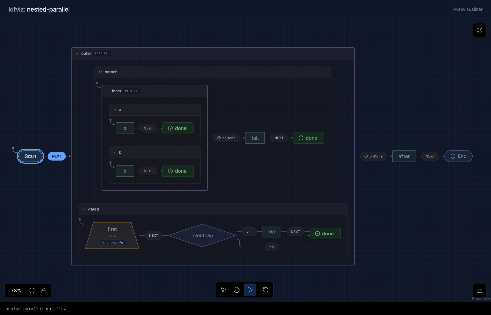

# aws-lambda-durable-functions-visualizer

[](https://www.npmjs.com/package/aws-lambda-durable-functions-visualizer)
[](https://opensource.org/licenses/MIT)

**See your AWS Lambda durable functions as diagrams, straight from the handler code: no deployment, no execution.**

<p align="center"></p>

Supports **TypeScript/JavaScript, Python, Java, C# (.NET), Rust and Go** [durable function](https://docs.aws.amazon.com/lambda/latest/dg/durable-functions.html) handlers. An independent project, not affiliated with or endorsed by Amazon Web Services.

## Quick start

```shell
npx aws-lambda-durable-functions-visualizer handler.ts --open
```

This opens the workflow in your browser, drawn by [Autovisualizer](https://github.com/jagreehal/autovisualizer). Install it globally for the short command `ldfviz`:

```shell
npm install -g aws-lambda-durable-functions-visualizer
ldfviz handler.py --open
```

Node.js 20 or later.

<p align="center"></p>

## Usage

```
Usage: ldfviz [options] <file>

Options:
  -d, --direction <dir>  Mermaid graph direction: TD or LR (default: "TD")
  -n, --name <name>      Override the workflow name
  --mermaid              Output Mermaid flowchart syntax instead of MachineJSON
  --graph                Output the raw workflow graph as JSON
  --json                 Alias for MachineJSON output (the default)
  -o, --output <file>    Write output to a file instead of stdout
  --open                 Open the diagram in your browser
  -V, --version          Output the version number
  -h, --help             Display help
```

| Output | Flag | Use it for |
| --- | --- | --- |
| MachineJSON | default | XState statecharts, e.g. in Autovisualizer |
| Mermaid | `--mermaid` | GitHub Markdown, Notion, docs sites |
| Workflow graph | `--graph` | Your own tooling |
| Browser page | `--open` | Autovisualizer, or Mermaid with `--mermaid` |

`BROWSER=none` makes `--open` write the page and print its path without launching a browser.

## What it draws

Steps, invokes, waits, callbacks, parallel branches (including nested ones and branches built in a variable), map callbacks, child contexts, retries, `if` / `else`, loops and promise combinators, with each primitive's configuration. Your code is parsed, never imported or run.

See the [full documentation](https://github.com/jagreehal/aws-lambda-durable-functions-visualizer#readme) for every supported primitive, a pull-request recipe, and the limits.

## Licence

MIT

Built on [durable-viz](https://github.com/gunnargrosch/durable-viz) by Gunnar Grosch. Thanks to him for the original parsers and idea.
